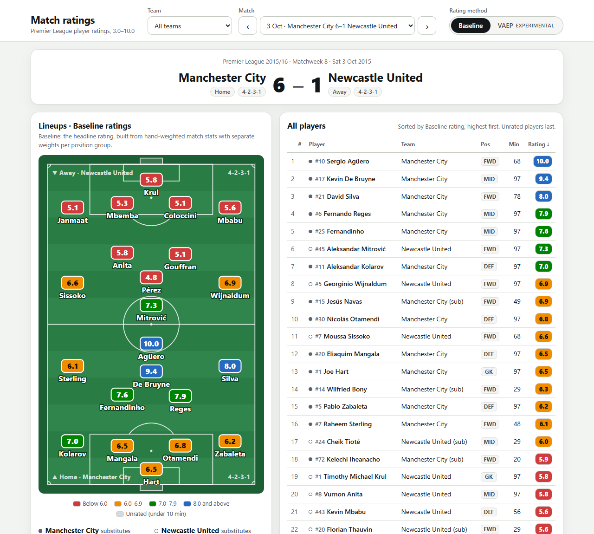

# Premier League player ratings

[](https://github.com/ethansye19/pl-player-ratings/actions/workflows/tests.yml)

Match-by-match player ratings on a **3.0–10.0 scale** for every Premier League match of
2015/16. The **headline rating is the baseline**; a second, experimental method runs alongside
for comparison:

1. **Baseline (headline)** – 35 per-match stats, hand-weighted with a separate weight profile
   per position group.
2. **VAEP (experimental)** – the value of every on-the-ball action, learned from the event
   data with [`socceraction`](https://github.com/ML-KULeuven/socceraction), summed per player
   per match. It is experimental because goals still barely count in it (see
   [Option 3](#option-3-the-vaep-scoring-fix-and-what-it-did-not-fix)).

Around them: a match page that draws both lineups on a pitch, a "why this rating?"
explanation feature that is checked against the player's own numbers, and a pipeline that
rates the current season from the official Fantasy Premier League API.

**Live page (2015/16 season):** https://ethansye19.github.io/pl-player-ratings/



*Manchester City 6–1 Newcastle United, 3 October 2015. Agüero's five goals earn one of the
three 10.0s of the season.*

## What a rating means

- Every player who was on the pitch for **10 minutes or more** gets a rating for that match.
- Ratings are **anchored**: over the season each position group (GK, DEF, MID, FWD) averages
  6.5, about a quarter of appearances fall below 6.0, and a **10.0 is extremely rare** (3 of
  10,133 rated appearances per method).
- A rating only compares a player with **other players of the same position group**. A
  7.5 for a centre-back and a 7.5 for a striker mean "better than the same share of their
  peers", not the same actions.
- Colours on the page: red below 6.0, orange 6.0–6.9, green 7.0–7.9, blue 8.0 and above,
  grey for players under 10 minutes.

The development and validation data is StatsBomb Open Data for the 2015/16 season:

| quantity | value |
|---|---|
| matches / teams | 380 / 20 |
| events | 1,313,773 |
| SPADL actions (VAEP input) | 757,641 |
| players who appeared | 550 |
| player-match appearances | 10,469 (10,133 with 10+ minutes) |

## How the two methods work

### Baseline: weighted match stats

Thirty-five stats are counted for each player from that match's events only, from goals and
expected goals down to pressures and goalkeeper claims. Each position group has its own
weight profile (GK 28 stats, DEF 32, MID 32, FWD 30), and the raw score is the weighted sum.
Every weight carries a one-line justification in `src/baseline/weights.py`; a few examples:

| stat | GK | DEF | MID | FWD |
|---|---:|---:|---:|---:|
| non-penalty goal | 4.0 | 3.5 | 3.0 | 3.0 |
| penalty scored | 1.25 | 1.25 | 1.25 | 1.25 |
| assist | 2.0 | 2.0 | 2.0 | 1.8 |
| non-penalty xG (per 1.0) | 1.0 | 1.0 | 1.5 | 1.5 |
| tackle won | 0.2 | 0.3 | 0.3 | 0.2 |
| possession lost | -0.5 | -0.25 | -0.25 | -0.15 |
| goal conceded while on the pitch | -1.0 | -0.4 | -0.3 | -0.2 |
| clean sheet (60+ minutes) | 1.5 | 0.5 | 0.25 | – |
| save / penalty save | 0.5 / 2.0 | – | – | – |
| yellow card / red card / own goal | -0.5 / -3 / -3 | same | same | same |

Team context (goals conceded, xG faced, clean sheets) is counted only while the player was on
the pitch. There is no minutes term: a substitute with nothing to show scores about 0, below
a quiet full-match starter and above anyone with a clearly negative game. The full table with
definitions is in `reports/baseline.md`.

### VAEP (experimental): the value of every action

VAEP (Decroos, Bransen, Van Haaren and Davis, *Actions Speak Louder than Goals*, KDD 2019)
values each on-the-ball action by how much it changes the team's chance of scoring, minus how
much it changes the chance of conceding, within the next ten actions. Two gradient-boosted
models (`lightgbm`) predict those probabilities from 568 features describing the action and
its two predecessors; a player's raw score is the sum of their action values in the match.

Two choices matter for the results:

- **Shots are valued by chance quality, not outcome.** The training labels are built from
  StatsBomb's expected goals (the probability that at least one chance in the window is
  converted) instead of whether a goal was scored. A goal is worth the chance it came from
  rather than a flat +0.8, a missed penalty is no longer a catastrophe, and a goalkeeper's
  save is credited with the chance it stops. `reports/vaep_splits.md` documents the
  formula and its effects.
- **No match is scored by a model that saw it.** A chronological holdout (train matchweeks
  1–19, score 20–38) and 5-fold cross-fitting over the whole season are both recorded with
  their full match lists in `vaep_splits.json`, and a test checks that no scored match is in
  its model's training set. Held-out AUC is about 0.81 for both the scoring and the
  conceding model.
- **Two scoring rules turn the probabilities into values ("option 3").** A penalty state's
  probability of scoring is set to the penalty's xG, because the models under-predict the 91
  penalty states. The action after an unscored shot is measured against the chance that is
  left once that shot has missed, so it no longer inherits the whole chance; a goalkeeper's
  save keeps the full credit. The models are not retrained (`src/vaep/value.py`).

VAEP values on-the-ball actions only, and its credit for defending is uneven. A goalkeeper's
saves are SPADL actions (`keeper_save`) and earn +0.085 each on average, 187 of the 262 VAEP
points goalkeepers collect over the season. Nothing charges a keeper for goals conceded,
though: the VAEP keeper rating is unrelated to the result (Spearman -0.06 with goal difference)
and barely repeats from one half of the season to the other (0.22). For defenders, a typical
clearance or tackle is worth about zero, and since option 3 a clearance after a missed shot is
worth at most +0.29. One tackle that ends a dangerous dribble can still be worth +0.37 and
decide a defender's rating, while results, clean sheets and cards barely register (defenders'
VAEP rating has Spearman +0.06 with goal difference, and players who were sent off average
5.97). The page therefore shows goalkeepers' baseline ratings in VAEP mode (marked "B"), and
VAEP ratings for defenders should be read with care (`reports/validation.md`, sections 6 and 8).

### From raw score to rating

Raw scores are only comparable within a position group, so each raw score becomes a
percentile within its group, and a fixed curve maps percentiles to ratings: 3.0 at the
bottom, 6.0 around the 25th percentile, a mean of 6.5, and 10.0 only above roughly the
99.96th percentile. The percentile tables are fitted once per season and frozen as JSON, so a
single match can be rated without touching any other match. `reports/scale.md` has the curve
and its rationale.

## Validation, and the weight fix before and after

After the first full run, an independent verification pass (`src/validation/`, report in
`reports/validation.md`) re-derived every rating rule from the output files, eye-tested the
top-20 ratings and five notable matches, compared the two methods, and measured whether a
player's ratings in the first half of the season predict the second half. It found no rule
violations, but it did find that defenders' baseline ratings were dominated by the scoreline,
that forwards were punished too hard for lost duels, and that outcome-labelled VAEP was a
goals-and-misses detector.

Five decisions were applied: team-context weights for DEF and MID halved; forwards' penalties
for lost aerials and lost possession eased; penalties separated from open-play goals (and
assists from key passes); VAEP shots valued through xG labels; goalkeepers shown with their
baseline rating in VAEP mode. The verifier then re-ran on the new outputs:

| quantity | before | after |
|---|---|---|
| Spearman(baseline, VAEP), all player-matches | 0.448 | 0.536 |
| ... GK / DEF / MID / FWD | 0.16 / 0.32 / 0.55 / 0.56 | 0.44 / 0.43 / 0.62 / 0.58 |
| ... season averages (393 players) | 0.613 | 0.677 |
| split-half stability (Pearson), baseline / VAEP | 0.544 / 0.411 | 0.564 / 0.518 |
| team-context share of baseline raw variance, DEF / MID / GK | 40% / 13% / 50% | 15% / 4% / 50% |
| Spearman(baseline rating, goal difference), DEF | 0.515 | 0.373 |
| VAEP value of an open-play goal / miss / keeper save | +0.838 / -0.053 / -0.004 | +0.120 / +0.020 / +0.085 |
| VAEP value of a converted / missed penalty to the taker | +0.063 / -0.752 | -0.112 / -0.298 |
| baseline 10–20 minute cameos: mean / share below 6.0 | 6.01 / 43% | 5.85 / 65% |

The two methods now agree more and both are more stable from one half of the season to the
other, while defenders' ratings depend less on the result. Several things got worse, and they
are documented rather than hidden. The VAEP numbers in this list are the xG-label VAEP as it
stood after those decisions, before option 3 below:

- **Under VAEP, goals barely counted.** With shots valued by xG, an open-play goal was worth
  +0.120 to the shooter on average and a miss +0.020, so scoring added about 0.1. Agüero's five
  goals against Newcastle rated 8.9 under VAEP (10.0 under the baseline), and 95 of the 870
  rated appearances with a goal rated below 6.0 under VAEP (3 under the baseline).
- **VAEP's credit for defending was close to a lottery.** The defending team's first action
  after an opponent's missed shot inherited the whole chance. Steve Cook's single clearance
  after a missed penalty was worth +0.50, 58% of his match total, and made him a 9.9
  (baseline 6.6). One tackle that ends a dangerous dribble could do the same: Patrick van
  Aanholt rated 9.8 in a 0-2 home defeat (baseline 6.0). Defenders' VAEP split-half
  stability fell from 0.44 to 0.29.
- **Under VAEP, a penalty cost the taker whether it went in or not.** A converted penalty was
  worth -0.112 to the taker on average and a missed one -0.298, because the models
  under-predict the 91 penalty states. The 71 rated penalty scorers averaged 6.28 under VAEP
  (7.51 under the baseline), and 45 of them rated below the 6.5 average.
- **Short baseline cameos drifted down** once the team-context terms that used to prop them
  up were halved: 10–20 minute appearances average 5.85 (was 6.01), and 65% of them are below
  6.0 (was 43%).

Section 7 of `reports/validation.md` has the full before/after tables, including every player
in the five notable matches.

### Option 3: the VAEP scoring fix, and what it did not fix

A second review (2026-11-02) compared three fixes for the VAEP problems above on a scratch copy,
and option 3 was applied: the two scoring rules described under the VAEP method. Nothing was
retrained and no baseline rating changed. Section 8 of `reports/validation.md` has the full
comparison.

| VAEP quantity | xG labels | option 3 | baseline |
|---|---|---|---|
| value of a converted / missed penalty to the taker | -0.112 / -0.298 | -0.010 / -0.011 | |
| penalty scorers' mean rating (71 appearances) | 6.28 | 6.81 | 7.51 |
| penalty missers' mean rating (16 appearances) | 5.60 | 7.06 | 6.52 |
| appearances with a goal rated below 6.0, of 870 | 95 | 75 | 3 |
| Agüero's five goals against Newcastle | 8.9 | 8.9 | 10.0 |
| most valuable single clearance | +0.54 | +0.29 | |
| split-half stability, defenders | 0.29 | 0.35 | 0.58 |
| split-half stability, all players | 0.52 | 0.54 | 0.56 |

- **Penalties are now neutral, so a miss is free.** A penalty is worth about -0.01 to the taker
  whether it goes in or not. Penalty scorers average 6.81 and players who missed a penalty
  average 7.06: under VAEP, missers average more than scorers. The baseline still separates
  them (7.51 and 6.52).
- **The defensive lottery is smaller but not gone.** Steve Cook's clearance after a missed
  penalty no longer carries his match: he rates 7.7 (was 9.9), and Cheikhou Kouyaté's 3-2 win at
  Everton falls from 9.5 to 6.7. Patrick van Aanholt's tackle ended a dribble rather than
  followed a shot, so he still rates 9.6 in a 0-2 home defeat. Defenders' VAEP split-half
  stability rose from 0.29 to 0.35, against 0.58 for the baseline.
- **Goals still barely count.** An open-play goal is worth +0.121 to the shooter and a miss
  +0.021. Agüero's five goals still rate 8.9, and 75 of the 870 appearances with a goal still
  rate below 6.0 under VAEP, against 3 under the baseline. This is why the baseline is the
  headline rating and VAEP is labelled experimental.

## Why this rating?

Every rating can be explained in a few sentences. The explanation is built from **only that
player's data in that match**: the rating, the raw score, and the five largest positive and
negative items (stat contributions for the baseline, individual actions for VAEP). A checker
then confirms that **each number in the text appears somewhere in that input**, after
rounding to at most three decimals and ignoring its sign. That is all it guarantees. It does
not check that a number is attached to the right stat, so "3 assists" passes whenever a 3
appears anywhere in the input, and it does not check claims written without digits, such as
"scored twice". The template provider writes each number next to the stat it came from; text
from the LLM provider has only the checker's guarantee.

```powershell
.venv\Scripts\python -m src.explain.explain --match 3754079 --player 3237 --method both
```

> Sergio Agüero (Manchester City, FWD) rated 10.0 with the baseline method in Manchester City
> 6-1 Newcastle United, playing 67.8 minutes. Agüero's 10.0 came mostly from 5 non-penalty
> goals (+15.00), non-penalty xG of 2.03 (+3.05) and 5 shots on target (+2.00). Against that,
> 5 possessions lost (-0.75) and 1 goal conceded while on the pitch (-0.20) pulled the score
> down. Raw score +19.89.

> Robert Huth (Leicester City, DEF) rated 10.0 with the baseline method in Manchester City 1-3
> Leicester City, playing 97.2 minutes. Huth's 10.0 came mostly from 2 non-penalty goals
> (+7.00), 5 blocks (+1.00) and 5 aerial duels won (+1.00). Against that, 1 goal conceded
> while on the pitch (-0.40) and 1 possession lost (-0.25) pulled the score down. Raw score
> +11.44.

> Roberto Firmino (Liverpool, FWD) rated 3.5 with the VAEP method in Leicester City 2-0
> Liverpool, playing 87.7 minutes. Firmino's 3.5 rests on a successful pass in minute 83
> (+0.03), a successful pass in minute 38 (+0.02) and an unsuccessful shot in minute 57
> (+0.02). The costliest moments were a bad touch in minute 77 (-0.24) and a bad touch in
> minute 67 (-0.11). Raw score -0.82.

The text above comes from the deterministic **template provider**, which needs no API key
and is the default. An **LLM provider** (Claude, through the official SDK) is wired up behind
`RATING_LLM_PROVIDER=anthropic` with `ANTHROPIC_API_KEY`; its output goes through the same
number check and falls back to the template text if it fails. It is not used by default.

## The current season: a gameweek pipeline on the FPL API

`python -m src.pipeline.gameweek` rates the latest finished gameweek of the current Premier
League season from three endpoints of the official Fantasy Premier League API:
`bootstrap-static` (gameweeks, teams, players), `fixtures/?event=<gw>` and
`event/<gw>/live` (every player's totals for the gameweek). FPL publishes per-gameweek
totals rather than events, so only the baseline method runs, and only **15 of its 35 stats**
exist there (`reports/fpl_mapping.md` lists every stat, its FPL field or the reason FPL lacks
it, and the two weight adjustments this forces). The scaler is fitted on all finished
gameweeks of the season so far, and the gameweek is published only if every check passes:
every team with a fixture has rated players, each side of every fixture has 11 starters in
the FPL data and every starter with 10 or more minutes is rated, ratings are finite and in
range with one decimal, and the gameweek mean is within 6.5 ± 0.3. Teams without a fixture
are not required, so a blank gameweek still publishes.

Each player gets one row per fixture. The gameweek totals are used only when a player played
exactly one fixture, for the club he had already joined. For everyone else who played, in a
double gameweek or after a transfer, the pipeline fetches that player's `element-summary`
history once, politely (at most one request a second), and takes starts, minutes, saves,
goals conceded, tackles, recoveries, CBI, xG and xG conceded per fixture, and the club from the
fixture, `was_home` and `opponent_team`. Those rows must add up to the gameweek totals; if they
do not, or a response or field is missing, the run fails and writes nothing. No stat is split
between fixtures or read as 0. A replay of gameweeks 1-8 moved five transferred players to the
clubs they played for and changed no rating (`reports/fpl_mapping.md`).

A PowerShell wrapper (`scripts/run_gameweek.ps1`) runs it from Task Scheduler once a day. It
does nothing when the latest finished gameweek is already published, writes nothing when a
check fails, and refuses to replace published output with an older gameweek or with fewer
fixtures or rated rows. When a run fails, whether a check failed, Python crashed or the venv is
missing, the wrapper also shows a Windows notification with the first failure line and the path
of `logs/pipeline.log`. A run that publishes or has nothing to do stays silent. If the main
Windows notifications switch is off, Windows would drop the notification, so the log says it was
not displayed instead. Current-season
output lives under `web/data/current/`, which is local only: the public page carries the 2015/16
season.

## Known limitations

- **Current-season ratings use FPL data only.** The FPL API has no passing, shot,
  dribble or duel counts, so 20 of the 35 baseline stats are missing there and
  midfielders are rated mainly on defensive actions (tackles, clearances/blocks/
  interceptions, recoveries) and team context (goals conceded, clean sheets, xG conceded);
  forwards mainly on goals, assists and xG. Treat current-season ratings as coarser than
  the 2015/16 ones, and expect quiet midfielders to cluster near the middle.
- Only the baseline method runs on the current season: VAEP needs event data.
- FPL positions follow the game's classification (wingers are usually MID), and FPL
  player names are short display names.
- VAEP is experimental. Goals still barely count in it, a missed penalty costs the taker
  nothing, it ignores goals conceded, and one tackle can still decide a defender's rating
  (see the caveat above and Option 3). Goalkeepers are shown with their baseline rating in
  VAEP mode, and the baseline is the headline rating.
- Explanations default to the template provider. The Anthropic provider is wired up
  behind `RATING_LLM_PROVIDER=anthropic` but has not been used or tested with a key.
- Ratings are percentile-anchored within each season: a 7.0 in 2015/16 and a 7.0 in the
  current season are both "better than about three quarters of the group", not the same
  underlying performance.
- The public page (`docs/`, served by GitHub Pages) contains the 2015/16 season only.
  Current-season ratings are not published.

## How this was built

This project was built with [Claude Code](https://claude.com/claude-code) in a spec-driven,
multi-agent workflow. The spec is [`PROMPT.md`](PROMPT.md): six steps, each ending in a
checkpoint. The working contract the agents followed (data rules, module interfaces, test
rules) is [`CLAUDE.md`](CLAUDE.md). Each step was built by parallel build agents, one per
module, and checked by an independent verifier agent that re-derived the numbers from the
processed data; its code is in `src/validation/` and its findings are in
[`reports/validation.md`](reports/validation.md).

I designed the spec, reviewed every checkpoint before the next step started, and made the
modelling decisions: the weight changes after the first validation pass, valuing shots by
their xG in the VAEP labels instead of counting only goals, showing goalkeepers with their
baseline rating in VAEP mode, and, after a second review, applying option 3 to VAEP while
making the baseline the headline rating and labelling VAEP experimental.

## Setup

Python **3.11** is required: `socceraction` 1.4.2 pins `pandas<2` and `numpy<2`, which have
no wheels for newer interpreters. The commands below are for Windows PowerShell; on macOS or
Linux use `.venv/bin/python` instead of `.venv\Scripts\python`.

```powershell
py -3.11 -m venv .venv
.venv\Scripts\python -m pip install -r requirements.txt   # fully pinned
.venv\Scripts\python -m pytest -q -m "not data"           # tests that need no downloaded data
```

GitHub Actions runs those same tests (`pytest -m "not data"`) with Python 3.11 on Windows for
every push and pull request to `main` (`.github/workflows/tests.yml`), with no secrets and no
network access in the tests. The tests marked `data` cannot run there: they check the processed
2015/16 season, and `data/` is never committed. Run the full suite locally after building the
data (below).

Reproduce the 2015/16 ratings from scratch (the download is about 1.1 GB; VAEP training
takes a few minutes):

> **Memory:** `src.vaep.train` needs about 6.6 GB of RAM for itself (measured peak with the
> cached features: 5.5 GiB resident, 6.2 GiB committed), because it holds all 757,641 game
> states in memory and copies each model's training set. Run it with at least 8 GB free; on a
> machine with 7 GB of RAM it was killed for running out of memory. The other steps need far
> less.

```powershell
.venv\Scripts\python -m src.ingest.download               # StatsBomb open data -> data/raw/statsbomb
.venv\Scripts\python -m src.ingest.build                  # -> data/processed/*.parquet, reports/ingest.md
.venv\Scripts\python -m src.baseline.rate                 # baseline stats and raw scores
.venv\Scripts\python -m src.vaep.train                    # VAEP features, models, action values, raw scores
.venv\Scripts\python -m src.scale.apply --method baseline # raw scores -> ratings
.venv\Scripts\python -m src.scale.apply --method vaep
.venv\Scripts\python -m src.pipeline.export_web           # JSON payloads for the page -> web/data/
.venv\Scripts\python -m http.server 8810 --directory web  # open http://localhost:8810
.venv\Scripts\python -m pytest -q                         # the full suite, including the data-backed rule tests
```

Other entry points:

```powershell
.venv\Scripts\python -m src.explain.explain --match <match_id> --player <player_id> --method baseline|vaep|both
.venv\Scripts\python -m src.pipeline.gameweek [--gw 8] [--if-new]      # current season -> web/data/current/
.venv\Scripts\python -m src.vaep.score                                  # re-score VAEP with the saved models (no retraining)
.venv\Scripts\python -m src.pipeline.export_site                        # rebuild the public site in docs/
.venv\Scripts\python -m src.validation.validate                         # regenerate reports/validation.md
```

`export_site` copies the page files and writes the 2015/16 payloads into `docs/`, then
verifies that the folder holds nothing else; `tests/test_site.py` repeats that check on the
committed folder. GitHub Pages serves `docs/` from the `main` branch.

To schedule the gameweek pipeline on Windows, register `scripts\run_gameweek.ps1` with Task
Scheduler (daily, with "run as soon as possible after a missed start"); the script header
explains its exit codes (0 = published or nothing to do, 1 = failed), the log it writes to
`logs/pipeline.log`, and the notification it shows when a run fails. The notification appears
only while you are logged on, which is when an interactive task runs.

## Repository layout

```
src/contract.py     the interface every rating method implements (columns, constants, validate_contract)
src/ingest/         download StatsBomb open data and build the processed parquet files
src/baseline/       stats, weights with justifications, raw scores, report
src/vaep/           splits, xG labels, lightgbm models, action values, report
src/scale/          percentile scaler, the target curve, colour bands
src/explain/        explanation inputs, number verification, template and LLM providers
src/pipeline/       web export, public-site build, FPL gameweek pipeline and stat mapping
src/validation/     the independent verifier behind reports/validation.md
web/                the match page (vanilla HTML/CSS/JS, no build step); web/data/ is generated
docs/               the public GitHub Pages site: the page plus the 2015/16 payloads
tests/              pytest suite; synthetic fixtures only
reports/            baseline, VAEP, scale, validation (with before/after) and FPL mapping reports
scripts/            the scheduled-task wrapper for the gameweek pipeline
PROMPT.md           the spec the project was built from, step by step
CLAUDE.md           the working contract the build agents followed
LICENSE             MIT, for the code (the data terms are below)
```

Raw data, processed data, logs and the current-season output are never committed
(`data/`, `logs/`, `web/data/` are gitignored).

## Data and credits

<a href="https://github.com/statsbomb/open-data"></a>

**Data provided by StatsBomb.** The 2015/16 ratings, the reports and the public page are
built from [StatsBomb Open Data](https://github.com/statsbomb/open-data) (Premier League
2015/16, `competition_id=2`, `season_id=27`), used under the
[StatsBomb Public Data User Agreement](https://github.com/statsbomb/open-data/blob/master/LICENSE.pdf),
which asks anyone publishing work based on the data to state StatsBomb as the source and to
use their logo. The ratings are the output of the two models described above, not StatsBomb's
own ratings.

Current-season data comes from the official
[Fantasy Premier League API](https://fantasy.premierleague.com/api/) and stays local.

VAEP is implemented with [`socceraction`](https://github.com/ML-KULeuven/socceraction)
(Decroos, Bransen, Van Haaren and Davis, "Actions Speak Louder than Goals: Valuing Player
Actions in Soccer", KDD 2019).

## License

The code in this repository is released under the [MIT License](LICENSE).

The StatsBomb data and everything derived from it are **not** covered by the MIT License.
The match payloads under `docs/data/` and the tables under `reports/` remain under the
[StatsBomb Public Data User Agreement](https://github.com/statsbomb/open-data/blob/master/LICENSE.pdf)
(StatsBomb's open data terms), not MIT. If you reuse them, state StatsBomb as the source and
use their logo, as that agreement asks.
